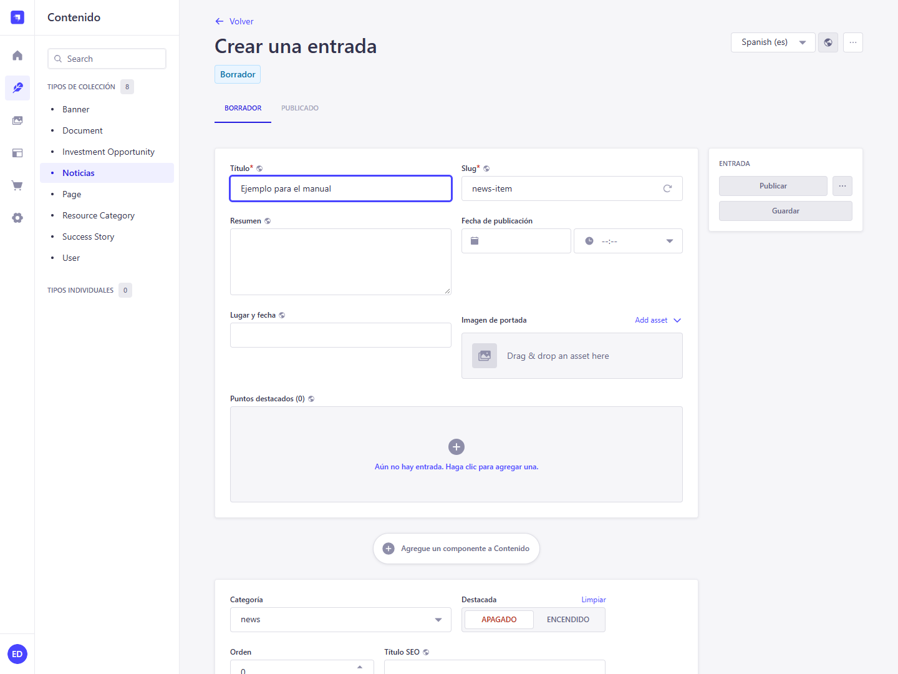
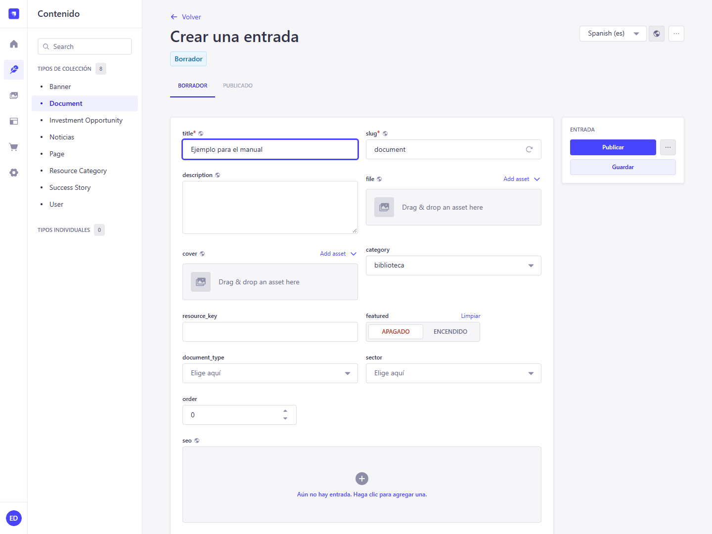
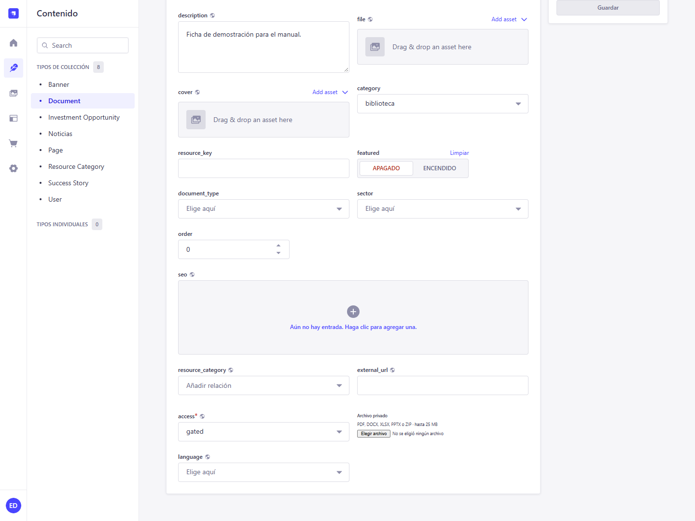
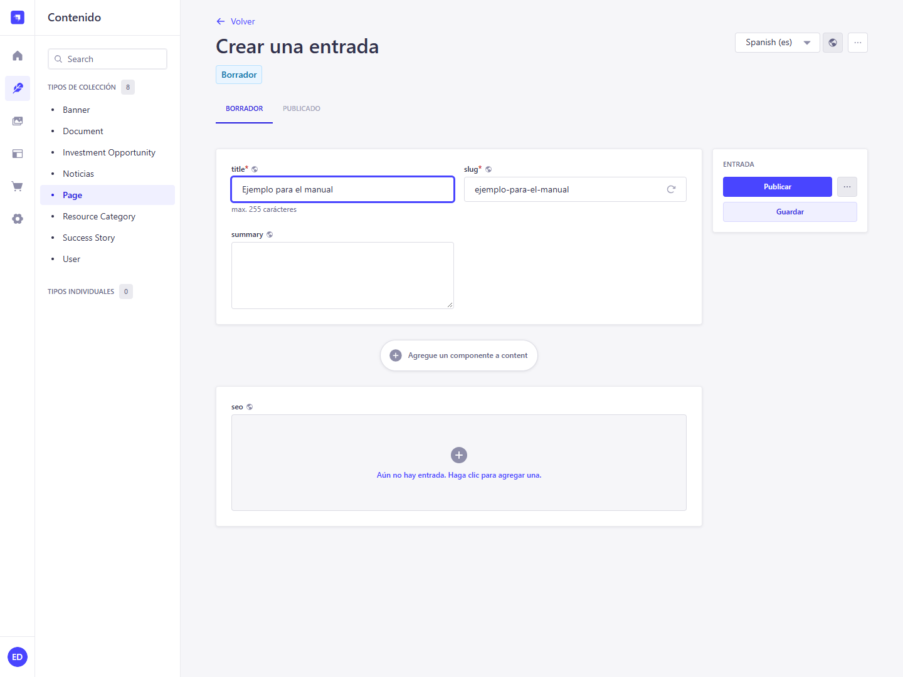

# Manual para editores de Strapi

Entra en `https://cms.test.cni.hn/admin` para validar cambios o en `https://cms.cni.hn/admin` para editar contenido de producción. En tu perfil puedes elegir **Español** para la interfaz. Dentro del **Gestor de contenido**, el selector de idioma corresponde a la traducción de la ficha. Selecciona **ES** o **EN** antes de editar.

Las capturas se tomaron con datos de ejemplo en Strapi 5.63. Algunas etiquetas de los campos se muestran en inglés según la colección.

## Crear una noticia

1. Abre **Gestor de contenido → Noticias (News) → Crear nueva entrada**.
2. Escribe el **Título**, revisa el **Slug** y añade un **Resumen**. Conserva el slug de una noticia ya enlazada. Elige la categoría y la fecha.
3. Añade la **Imagen de portada** y registra el texto alternativo en la biblioteca multimedia. En **Contenido** agrega los bloques de párrafo, subtítulo, imagen o cita que correspondan.
4. Guarda el borrador. Abre la vista previa cuando esté disponible, revisa portada y texto, y sigue el paso de publicación. Verifica la noticia en **Prensa**.

## Subir un recurso libre

1. Abre **Document → Crear nueva entrada**. Completa título, slug y descripción. Selecciona la categoría de recursos que corresponda.
2. En **Access**, selecciona **free (Libre)**. En **File (Archivo)**, elige o sube el documento a la biblioteca multimedia.
3. Guarda y publica. Abre la categoría del portal en una ventana privada y comprueba que el archivo abre sin formulario.

## Subir un recurso con formulario

1. Crea o abre un **Document**, elige la categoría y selecciona **gated (Con formulario)** en **Access**. Deja vacío **File** y cualquier enlace público.
2. Guarda el borrador. En la misma ficha, selecciona el archivo en **Archivo privado**. Los formatos admitidos son PDF, DOCX, XLSX, PPTX y ZIP de hasta 25 MB.
3. Espera el mensaje que confirma que el archivo quedó vinculado. Guarda otra vez y publica. Si la carga falla, revisa formato y tamaño o pide al administrador verificar el almacenamiento.
4. Abre el recurso desde una sesión privada. Comprueba que se muestra **Descargar con formulario** y prueba la descarga con datos autorizados.

## Crear un banner

1. En **Banner → Crear nueva entrada**, completa el título y el mensaje. Selecciona **site_top** para la barra superior del portal.
2. Si incluye llamada a la acción, añade el texto del botón y la URL de destino. Revisa la fecha de inicio, la fecha de fin y la prioridad. Verifica el contraste de los colores y si el aviso se puede cerrar.
3. Guarda y publica. Comprueba el banner en una página pública, durante su ventana de vigencia y con la fuente editorial configurada en Strapi.

## Crear o editar una página

1. En **Page**, abre la entrada existente o crea una nueva. Completa título, slug, resumen y contenido. Coordina los cambios de slug si la página ya tiene enlaces públicos.
2. Revisa SEO y traducciones. Guarda. Usa la vista previa cuando esté disponible y verifica el contenido publicado en `/institucional/<slug>` o `/en/institutional/<slug>`.

## Publicar cambios

1. Tras guardar, revisa el idioma, los enlaces y el contenido del borrador. Si tu rol solo permite editar, pide a un publicador que revise la entrada.
2. Haz clic en **Publicar** y confirma si el panel lo solicita. El estado debe quedar en **Publicado** para ese idioma. Repite la revisión y publicación por cada traducción.
3. Abre el sitio público en una ventana privada para verificar el resultado. Si debes retirarlo, usa **Despublicar** en la variante correspondiente y verifica que se retiró del portal.
